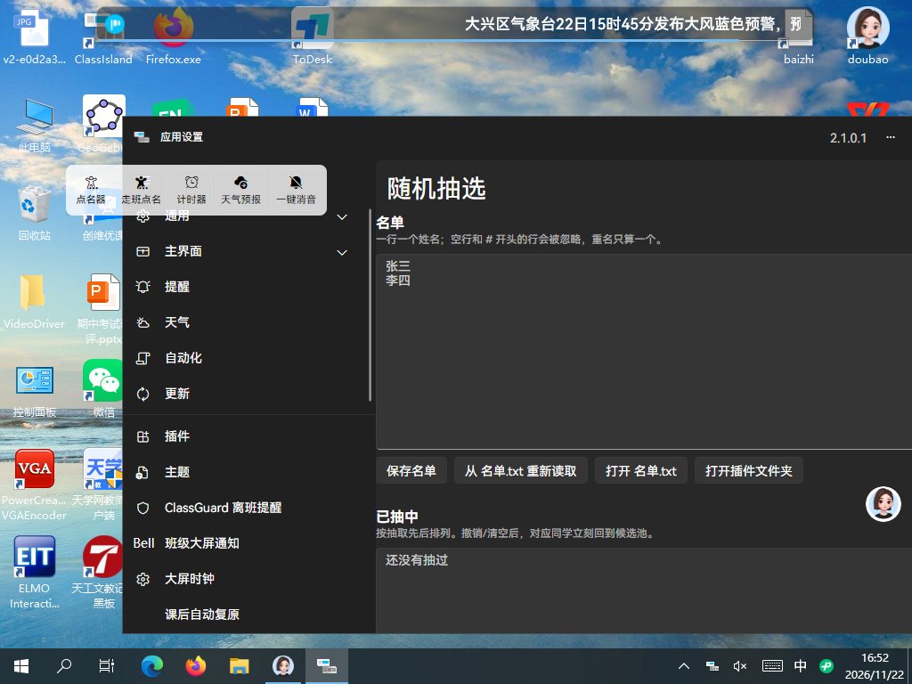

# 随机抽选（ClassIsland 插件）

[](https://github.com/leaf5049/leaf5049-randomcall-stack/releases/latest)
[](https://github.com/leaf5049/leaf5049-randomcall-stack/releases)
[](LICENSE)
[](https://github.com/ClassIsland/ClassIsland)

给 [ClassIsland](https://github.com/ClassIsland/ClassIsland) 用的公平点名器：在「行动」里加一个「随机抽选」，点一下就从名单里抽一名同学，用 ClassIsland 原生通知遮罩显示 3 秒并朗读，抽中的人会被记录，按滑动窗口保证同一周期内不重复。

- 插件 id：`leaf5049.randomdraw`
- 行动：`leaf5049.randomdraw.pick`（名称「随机抽选」，位于「点名」分组）
- 设置页：`leaf5049.randomdraw.settings`（设置 → 随机抽选）
- 目标 API：ClassIsland 2.x（`apiVersion: 2.0.0.0`，开发验证于 2.1.0.1）

## 设置页预览



## 功能

- **公平抽选**：候选池 = 全名单 − 已抽中名单，抽中后追加到已抽中；已抽中数量达到「滑窗大小」（默认 24）后，每抽一次就淘汰最早抽中的那位。39 人班、滑窗 24 → 候选池恒为 15 人，被抽中者接下来 23 次抽选内不会再出现。
- **原生遮罩**：用 `NotificationTwoIconsMaskTemplate` 显示姓名，3 秒自动消失；朗读走 ClassIsland 自带 TTS（关掉提醒音效，避免和朗读叠声）。
- **设置页**：名单多行编辑、已抽中查看/撤销/清空、滑窗大小（1–500）可调，全部落在插件自己的数据文件里，不用翻文件夹。

## 在应用内直接安装

**方式一：官方插件市场（审核通过后）**

插件已提交到 ClassIsland 官方插件源（[PluginIndex PR #240](https://github.com/ClassIsland/PluginIndex/pull/240)）。合并后即可在 设置 → 插件 → **市场** 里搜到「随机抽选」，点安装，后续版本也会在应用里提示更新。

**方式二：添加作者的自定义插件源（不用等审核，立即可用）**

1. 设置 → 插件 → 切到「市场」标签页
2. 点右上角「…」→ **管理插件源** → 自定义插件源 → 点「+」
3. Url 填入：`https://github.com/leaf5049/leaf5049-randomcall-stack/releases/download/market/leaf5049-market.zip`
4. 确定 → 关闭抽屉 → 在市场页点「刷新」
5. 列表出现「随机抽选」后点下载安装，按提示重启 ClassIsland

> 访问 GitHub 慢的话，可在「管理插件源」里把镜像换成 `ghproxy` 或 `moeyy` 再刷新。

## 本地安装

1. 下载 **[leaf5049.randomdraw.cipx](https://github.com/leaf5049/leaf5049-randomcall-stack/releases/latest/download/leaf5049.randomdraw.cipx)**（约 112 KB），在 ClassIsland → 设置 → 插件 → 从本地安装。
2. 或者在 ClassIsland 里打开插件目录，把 `leaf5049.randomdraw` 文件夹放进去后重启。
3. 到 设置 → 自动化 → 新建行动组，添加「随机抽选」（点名分组），给它配一个触发器（热键、时间点、浮动按钮都可以）。
4. 名单：第一次运行会生成示例 `名单.txt`；也可以在 设置 → 随机抽选 里直接编辑保存。

## 数据文件

插件文件夹里：

- `名单.txt`：一行一个姓名，空行和 `#` 开头的行会被忽略。
- `抽选数据.json`：数据库。

```json
{
  "allNames": ["张三", "李四", "王五"],
  "pickedNames": ["李四"],
  "maxPickedCount": 24
}
```

- `allNames` 为空时才会从 `名单.txt` 读取并回写；非空时优先用 JSON。
- `pickedNames` 按抽取先后记录，满 `maxPickedCount` 后自动删掉最早的（没有「重开一轮」逻辑，记录不会被清空）。
- 随机数取自操作系统熵源（`RandomNumberGenerator`），不是时间种子。

## 从源码构建

需要 .NET 8 SDK，以及本机安装的 ClassIsland（要引用它自带的 `ClassIsland.Core.dll` 等程序集）。

```powershell
$env:CLASSISLAND_DIR = "C:\Program Files\ClassIsland\app-2.1.0.1-0"   # 指向含 ClassIsland.Core.dll 的目录
.\build.ps1                     # 编译 + 跑全部测试
.\build.ps1 -DeployTo "C:\...\ClassIsland\data\Plugins"   # 顺便部署到本机 ClassIsland
.\build.ps1 -Package            # 顺便出 dist\leaf5049.randomdraw.cipx
```

测试分四组，都是不启动 ClassIsland 的离线测试：

| 目录 | 覆盖 |
| --- | --- |
| `tests/store` | 数据层：读 txt / 优先 JSON / 补集不重复 / 滑窗淘汰 / 持久化 / 名单与滑窗修改 |
| `tests/harness` | 行动逻辑：遮罩模板、文本、3 秒、朗读、关音效、写入已抽中 |
| `tests/registration` | 注册流程：行动、提醒提供方、设置页、行动菜单分组 |
| `tests/ui` | 设置页在真实 Avalonia 环境里的构建与按钮行为 |

## 常见问题

- **提示「此提醒提供方 id 已经被占用」或 `Key: 随机抽选` 冲突**：说明同一台机器上还装着另一个同名/同分组（「点名」）的抽选插件，ClassIsland 会同时加载两者。把旧的插件文件夹从 `data\Plugins` 里移走（不是改名，改名仍会被加载）再重启即可。
- **点了没有反应**：先确认行动确实挂上了触发器；再检查 `data\Logs` 里的最新日志（日志在进程退出时才落盘，运行中通常是 0 字节）。

## 协议

MIT，见 [LICENSE](LICENSE)。
